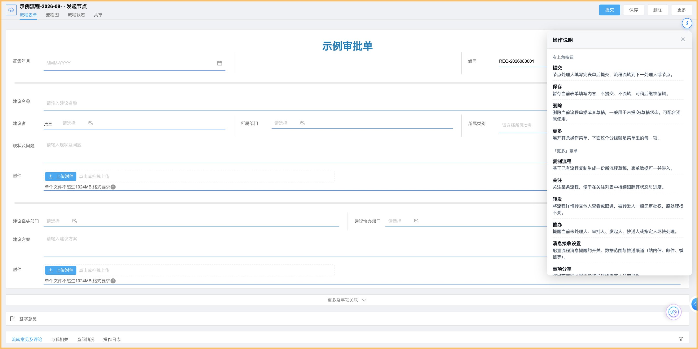

# e10-ecode-workflow-action-guide

  

**A floating "what do these buttons do?" guide for the Weaver e-cology10 workflow page — bound to operation codes instead of button labels, and shown in the user's own language.**



## The problem

A workflow page has a row of action buttons in the top-right corner (Submit / Save / Delete / More),
and the **More** menu hides another dozen-plus operations. Their names are translated, often
domain-specific, and — worst of all — **an administrator can rename any of them**. So:

- users cannot tell what each button actually does;
- any documentation (or tooltip) that matches buttons by their **label** breaks the moment
  somebody renames a button or switches the UI language.

## What this app does

- Adds a small floating **`i`** button just below the workflow action bar.
- Clicking it opens a panel with two groups: **Top-right buttons** and **"More" menu**, each row
  being `name + one-sentence explanation`.
- The **name shown is the platform's current title**, so if an administrator renames
  "Save" to "Save as draft", the guide shows *Save as draft* — while the explanation still comes
  from the operation itself.
- The explanation language follows `weappUtils.getLang()`: `zh*` → Chinese, anything else → English.
  Switching the UI language re-renders the panel **without a page reload**.
- It never clicks, submits, or modifies a platform node. Pages with nothing to explain get
  **no injected node at all**.

## How it works

### 1. Bind to the operation code, never to the label

The platform exposes the current operation list through its JS SDK:

```js
window.weappWorkflow.getFlowPageSDK().baseStore.operMenus
// → [{ menutype: 'SUBMIT',     title: '提交', istop: 1, useable: 1, orderid: 0,  … },
//    { menutype: 'SAVE_DATA',  title: '保存', istop: 1, useable: 1, orderid: 5,  … },
//    { menutype: 'DELETE',     title: '删除', istop: 1, useable: 1, orderid: 6,  … },
//    { menutype: 'IMPORT',     title: '复制流程', istop: 0, … }, …]
```

Three fields do all the work:

| Field | Meaning | Why it matters |
| --- | --- | --- |
| `menutype` | Stable operation code (`SUBMIT`, `SAVE_DATA`, `REMIND`, …) | **Does not change when the button is renamed or translated** |
| `istop` | `1` = rendered as a top-right button, otherwise it lives in the More menu | Splits the two groups exactly like the UI does |
| `title` | The platform's current display name | Used **for display only** — always matches what is on screen |

Everything else is a lookup: `menutype` → entry in the explanation table → localized name + description.

### 2. Language follows the platform, not a setting of our own

```js
weappUtils.getLang()   // 'zh_CN' / 'en_US' / …
```

The module re-reads it on every tick (800 ms), which is why switching the interface language
updates the panel without a reload.

### 3. Positioning is measured, not hardcoded

The first version pinned the button with `top: 52px`. That breaks in two different ways:

- Pages that show a **"item 1 of 3 — previous / next" strip** push the whole toolbar down
  (the action bar grows from ~30 px to ~54 px tall), so a fixed offset lands **on top of the
  "More" button**.
- The action-bar *container* has its own padding — measured 13 px below the actual buttons —
  so anchoring to the container instead of the buttons makes the entry look too low.

So the module measures the buttons themselves and re-measures on every tick:

```js
// top = lowest bottom edge of the buttons in the action bar, + 8px
// (falls back to the container, then to 52px, if nothing can be measured)
launcher.style.top = Math.round(bottom + 8) + 'px';
panel.style.top    = Math.round(bottom + 8 + 36) + 'px';
```

### 4. Degradation is silent

| Situation | Behaviour |
| --- | --- |
| `getFlowPageSDK()` unavailable | Falls back to reading the DOM: `.ui-title-right-container button` for the top row, and the menu items through `__WEAPP_AGENT_BRIDGE__.describe(menuId)` (no need to open the menu), matched **by name** |
| An operation is not in the table | That row is simply not rendered — nothing is invented |
| No action bar / not a `/sp/workflow/` page | No node injected, nothing observable on the page |
| The platform replaces the DOM block | The entry re-mounts itself on the next tick |
| The lazy chunk fails to load | `entry.js` logs and leaves the page exactly as it was |

## Project structure

```
e10-ecode-workflow-action-guide/
├── entry.js                          # route check + async load (preloaded entry)
├── build.json                        # app metadata (ids blank → generated on first build)
├── coms/
│   └── WorkflowActionGuide.js        # operation table, binding, i18n, panel lifecycle
├── styles/
│   └── workflow-action-guide.css     # .wfg-* only (launcher + panel), ~130 lines
├── config/                           # standard e-code app config files (untouched)
└── screenshot.jpg
```

| File | Preload | Role |
| --- | --- | --- |
| `entry.js` | yes | Only checks `location.pathname` and lazily loads the business module; stops its own poll once loaded |
| `coms/WorkflowActionGuide.js` | no | Detection (`operMenus` → DOM fallback), 54-entry explanation table, language resolution, panel rendering, mount/unmount/self-heal |
| `styles/workflow-action-guide.css` | yes | Launcher + panel, `z-index` 1050 / 1040 |

### Layers

`1050` (launcher) / `1040` (panel): above the platform's dropdown layer (`999`), below platform
dialogs — so the guide never covers a dialog and a dropdown never covers the guide.

## Scope

- PC workflow pages under `/sp/workflow/` (the per-request action bar).
- Workflow **list** pages (`/workflow/list/center`) have no such action bar and no `operMenus`,
  so nothing is injected there by design.
- Verified against e-cology10 with `@weapp/ecodesdk` 0.1.54, `@weapp/ui` 0.0.389-hotfix11 and
  agent bridge 0.2.0 (read from `weappEcodesdk.version` / `weappUi.version` at runtime).

## Build & deploy

Requires Node.js plus the E10 e-code dev-tools package (`ecodecmd-e10` for compile/build, and an
import path such as `ecode-cli` or the e-code console).

```bash
# compile check
node <e10-devtools>/ecodecmd-e10.mjs compile .

# build → .target/<appId>.zip
node <e10-devtools>/ecodecmd-e10.mjs build .

# import into a project (add the platform's publish option to make it live)
node <e10-devtools>/ecode-cli.mjs package import --file .target/<appId>.zip --project-id <projectId>
```

> `build.json` ships with **blank `id` / `appUUID`**, so the first build generates new ones and
> importing creates a brand-new app. To *update* an app that is already on the platform, download it
> first (or fill in its real ids) so the import matches by `appUUID`.
>
> Note that an imported app is **not live until it is published** — with e-code tooling that is the
> import `--auto-publish` flag (or the publish action in the e-code console).

## Customising

**Add an operation to the guide.** Look up its `menutype` on any workflow page:

```js
window.weappWorkflow.getFlowPageSDK().baseStore.operMenus
```

then add one line to `MENU_TYPES` in `coms/WorkflowActionGuide.js`:

```js
const MENU_TYPES = {
  // … existing entries …
  AGREE: '批准',      // menutype: entry in the explanation table
};
```

**Edit or translate the explanations.** They live in one array, `ACTIONS`:

```js
{ zh: '提交', en: 'Submit',
  zd: '节点处理人填写完表单后提交，流程流转到下一处理人或节点。',
  ed: 'Handler completes and submits the form; the workflow routes to the next assignee or node.' }
```

`zh` / `en` are matching keys (used only if `menutype` cannot be resolved); `zd` / `ed` are what
the panel actually prints.

## 中文说明

给泛微 **e-cology10** 流程页右上角加一个悬浮的 **`i`**，点开用**当前用户的语言**说明
「右上角按钮」和「更多菜单」里每一项是什么操作。

- **绑定的是操作码，不是按钮名称**：数据取自平台官方口子
  `weappWorkflow.getFlowPageSDK().baseStore.operMenus`，其中 `menutype`（`SUBMIT` / `SAVE_DATA` /
  `REMIND` …）是稳定标识，**管理员改按钮名、界面切语言都不会变**；`istop===1` 决定它属于
  右上角按钮还是「更多」菜单；`title` 只用于显示，所以面板里显示的名字永远和屏幕一致。
- **释义按 menutype 取**：面板每行 = 平台当前名称 + 该操作的中/英释义，改名的按钮照样能给出正确解释。
- **语言跟随平台**：`weappUtils.getLang()`，`zh*` 走中文、其余走英文；每 800ms 重读一次，
  **切换语言不用刷新页面**。
- **定位是量出来的，不是写死的**：入口 `top` 取动作条内按钮的真实底边 +8。
  写死偏移会在带「第 N 条(共 M 条)」条幅的页面上压住「更多」；贴容器底边又会偏下
  （实测容器比按钮低 13px）。
- **降级是静默的**：拿不到 `getFlowPageSDK()` 时退回读 DOM + `__WEAPP_AGENT_BRIDGE__.describe()`
  按名称匹配；表里没有的操作不显示、不臆造；页面没有动作条就一个节点都不注入。
- **生效范围**：PC 端 `/sp/workflow/` 下的流程页；流程列表页（`/workflow/list/center`）没有这种
  逐单动作条，也不注入。
- **层级**：入口 `1050`、面板 `1040`（高于平台下拉 `999`，低于平台弹窗）。
